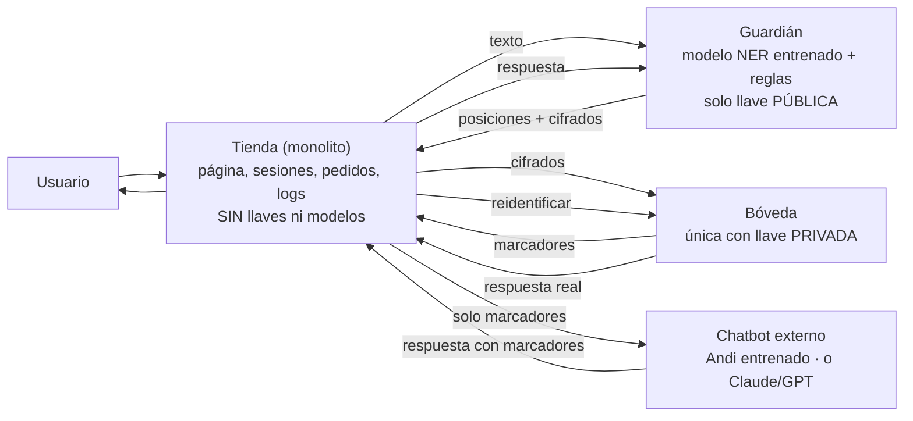

# FDSI-GP-04 — Protección de datos personales enviados a un LLM

Proyecto del Seminario Aplicado de Ciberseguridad en IA (2026-2).
Integrantes: Johan Sebastián Beltrán Gutiérrez, Andrés Camilo Vivas Baquero y Sara Viviana Arteaga Rodríguez.

**Andes Market** es una tienda en línea colombiana completa: catálogo, carrito, compra, seguimiento de pedidos y cuentas de usuario con inicio de sesión, con un chatbot de IA, **Andi**. El chat tiene dos modos, que son las dos arquitecturas de la propuesta:

- **Modo inseguro (Unsecure):** el mensaje llega tal cual al chatbot y queda completo en el log. Solo lo puede usar el administrador, desde el Centro de seguridad, como línea base de la demostración.
- **Modo seguro (Secure):** un **modelo guardián, entrenado por el equipo**, detecta los datos personales y los **cifra con una llave pública** antes de que el mensaje llegue al chatbot. El chatbot y el log solo ven marcadores (`[CORREO_1]`). Solo la **bóveda**, que tiene la llave privada, puede volver a ver el dato real.

La explicación completa, en lenguaje sencillo, está en [docs/COMO_FUNCIONA.md](docs/COMO_FUNCIONA.md), y la guía para instalarlo en otro computador, con los usuarios de prueba, en [docs/INSTALACION_Y_CREDENCIALES.md](docs/INSTALACION_Y_CREDENCIALES.md).

## Arquitectura: cuatro servicios separados



| Servicio | Carpeta | Qué tiene | Qué NO tiene |
|---|---|---|---|
| Tienda | `app/` | Página web, usuarios e inicio de sesión, catálogo, carrito, pedidos (SQLite), logs, tokens para hablar con los otros | Ninguna llave de cifrado, ningún modelo |
| Guardián | `guardian/` | Modelo NER propio, reglas de validación, llave **pública**, pimienta del índice ciego | Llave privada, disco escribible, salida a internet, memoria entre peticiones |
| Bóveda | `vault/` | Llave **privada**, datos cifrados **solo en memoria** y con vencimiento, bitácora de accesos en memoria | No escribe en disco; no interpreta texto; no habla con el chatbot |
| Chatbot | `chatbot/` | Modelo de intenciones Andi (o API de Claude/GPT) | Ninguna llave; no alcanza a la bóveda ni al guardián |

En Docker, cada servicio corre en su contenedor con su red. El guardián y la bóveda están en redes internas sin salida a internet, y el guardián tiene el disco en solo lectura. Esto se verificó desde dentro de los contenedores.

### La bóveda es efímera

La bóveda **no guarda nada en disco**: ni los datos cifrados ni la bitácora. Un archivo así sería un blanco de robo y dejaría los datos vivos después de la conversación.

- Los marcadores y sus datos cifrados viven **solo en la memoria** del servicio, separados por conversación.
- Cada conversación **vence tras 30 minutos sin actividad** (`VAULT_SESSION_TTL_SECONDS`, por defecto 1800). Cada mensaje renueva el plazo.
- Hay un tope de conversaciones simultáneas (`VAULT_MAX_SESSIONS`, por defecto 1000). Al llegar al tope se borra la de actividad más antigua.
- Al **cerrar sesión**, la tienda le pide a la bóveda borrar las conversaciones seguras de ese usuario (`DELETE /session/{id}`).
- Si se reinicia la bóveda, todo se pierde.
- Cuando una conversación vence, sus marcadores ya no se pueden reidentificar ni resolver: la respuesta muestra `[CORREO_1]` en vez del dato, sin errores.

**Ojo:** mientras la conversación está abierta, los datos cifrados siguen en la memoria del proceso de la bóveda. Alguien con acceso a esa memoria y a la llave privada podría leerlos durante ese tiempo.

## Resultados

`python -m scripts.evaluate --live`, con los cuatro servicios hablando por HTTP real.

**Detección del guardián** sobre dos conjuntos escritos a mano que **nunca se usaron para entrenar**:
- Conjunto principal: 50 mensajes, 40 datos personales y 15 controles.
- Hold-out: 30 mensajes, 24 datos personales y 9 controles.

| Modo del guardián | Recall (principal) | Falsos positivos (principal) | Recall (hold-out) | Falsos positivos (hold-out) |
|---|---|---|---|---|
| Solo modelo entrenado | 0.975 | 0.067 | **0.958** | 0.000 |
| Solo reglas | 0.950 | 0.000 | 0.750 | 0.000 |
| **Híbrido (el que se usa)** | **1.000** | **0.000** | **0.958** | **0.000** |

**Sistema completo (modo híbrido):**

| Métrica de la propuesta | Resultado | Meta |
|---|---|---|
| Recall de detección | 1.00 | ≥ 0.90 |
| Falsos positivos | 0.00 | ≤ 0.10 |
| Fuga de datos hacia el chatbot | 0 | 0 |
| Latencia añadida (4 servicios por HTTP) | ≈ 52 ms | ≤ 500 ms |
| Utilidad (similitud de embeddings) | 0.91 | ≥ 0.80 |

- **T03 (resumen):** en modo inseguro el chatbot repite 4 de 4 datos reales; en modo seguro, 0.
- **T05 (estado del pedido):** 10 de 10 respuestas correctas en ambos modos, sin que el correo ni la cédula lleguen al chatbot. En modo seguro cada consulta la hace el cliente dueño del pedido.

**Transparencia sobre las cifras.** La primera medición del guardián entrenado, guardada en `data/guardian_primera_medicion.json`, fue:
- 0.975 de recall en el conjunto principal y 0.958 en el hold-out;
- 1 fuga y T05 en 9/10.

Viendo esos fallos se hicieron dos ajustes generales: más variedad sintética (textos largos, apellidos inventados) y validadores en el modo híbrido. Por eso la tabla del modo híbrido ya no es una medición ciega. En cambio, el resultado del **modelo solo en el hold-out (0.958)** se mantuvo igual antes y después, y es la mejor estimación de cómo generaliza. Lo único que no detecta es una dirección rural ("vereda El Rosal, finca La Esperanza").

## La tienda: base de datos, usuarios y seguridad de la cuenta

**Base de datos:** SQLite, en el archivo `data/db/andes_market.db`. Se crea sola al arrancar la tienda y se llena con `data/seed/`: 12 productos, 6 usuarios de prueba y sus pedidos. Para empezar de cero, borren la carpeta `data/db/`.

| Tabla | Contenido |
|---|---|
| `usuarios` | Correo, nombre, cédula, celular, dirección, rol (`cliente` o `admin`) y hash de la contraseña |
| `sesiones` | Hash SHA-256 del token de cada sesión iniciada y su vencimiento |
| `productos` | Catálogo con precio, inventario y calificación |
| `carrito` | Productos en el carrito de cada usuario |
| `pedidos`, `pedido_items` | Pedidos con estado, transportadora, fecha de entrega y productos |

**Usuarios de prueba:** las cuentas (un administrador y cinco clientes) y sus contraseñas están en [`data/seed/usuarios_demo.json`](data/seed/usuarios_demo.json).

**Cómo se protege la cuenta:**
- Las contraseñas se guardan solo como hash **scrypt** con sal. Al registrarse se exigen 8 caracteres con letras y números.
- La sesión es un token aleatorio en una cookie `HttpOnly` + `SameSite=Lax`, que dura 8 horas. En la base solo queda su hash.
- Tras 5 intentos fallidos con el mismo correo, ese correo se bloquea 15 minutos.
- Cada conversación del chat pertenece al usuario que la inició. El servidor genera el id y no acepta ids inventados ni de otra persona, así que nadie puede pedirle a la bóveda los datos de otro usuario.
- **Control de acceso a pedidos:** un cliente solo puede consultar sus propios pedidos, también por el chat (escribir el correo o el código de pedido de otra persona no sirve). Si pregunta por "mi pedido" sin dar datos, se usa la cuenta con la que inició sesión, así que no necesita escribir información personal.
- El modo inseguro y el Centro de seguridad (`#/seguridad`) son solo para el rol `admin`.

## Cómo correrlo

**Requisito:** Python 3.11 o 3.12 (en Windows: `py install 3.12`).

```bash
py -V:3.12 -m venv .venv
.venv\Scripts\activate
pip install -r requirements.txt
python -m spacy download es_core_news_md
python -m scripts.setup_secrets
python -m scripts.run_all
```

Abre **http://127.0.0.1:8000**. `run_all` arranca los cuatro servicios en procesos separados (tienda 8000, guardián 8101, bóveda 8102, chatbot 8103), y cada uno recibe solo sus propios secretos. Si falta el chatbot entrenado, se entrena solo. El guardián ya viene entrenado en `models/guardian_ner/`.

Ingresa con un usuario de `data/seed/usuarios_demo.json`. Con la cuenta del **administrador**, el chat muestra el selector de modo seguro o inseguro, los ejemplos T01–T05 y "Ver auditoría", y el menú "Mi cuenta" incluye el **Centro de seguridad**.

### Con Docker

```bash
python -m scripts.setup_secrets
docker compose up --build
```

### Pruebas, evaluación y reentrenamiento

```bash
pytest -q
pip install -r requirements-eval.txt
python -m scripts.evaluate
python -m scripts.evaluate --live
python -m scripts.train_guardian
python -m scripts.train_bot
```

- `pytest -q`: 68 pruebas, incluidas las de aislamiento, bóveda efímera, inicio de sesión, carrito, pedidos y control de acceso.
- `python -m scripts.evaluate`: evaluación con los servicios en memoria.
- `python -m scripts.evaluate --live`: evaluación contra los servicios de `run_all`.
- `python -m scripts.train_guardian`: reentrena el guardián (unos 4 minutos).
- `python -m scripts.train_bot`: reentrena el chatbot Andi.

### Usar Claude como chatbot (opcional)

Copia `.env.example` a `.env` y pon `CHATBOT_LLM_PROVIDER=anthropic` y `CHATBOT_ANTHROPIC_API_KEY=...`. Solo el servicio chatbot recibe esa clave, y Claude solo vería marcadores. No se probó porque no hay clave configurada.

## Limitaciones

- El guardián ve el dato en claro durante unos milisegundos: detectar sin leer es imposible. Lo que se garantiza es que no puede guardarlo, enviarlo afuera ni descifrarlo después. Evitar incluso ese instante requeriría detectar en el navegador del usuario o usar computación confidencial (enclaves); queda como trabajo futuro.
- No detecta direcciones rurales sin nomenclatura urbana. Una cédula escrita como número suelto, sin prefijo ni puntos, no se detecta a propósito, para no marcar cualquier número.
- El chatbot Andi clasifica intenciones y responde con plantillas; no es un LLM generativo.
- El historial del chat vive en memoria (se pierde al reiniciar la tienda); los usuarios, carritos y pedidos sí quedan en la base.
- Los datos personales de la tabla `usuarios` se guardan en claro dentro de la tienda (es la responsable del tratamiento). Cifrarlos en reposo sería una mejora.
- No hay recuperación de contraseña por correo ni segundo factor.
- Los pagos (PSE y tarjeta) son simulados: no se conecta a una pasarela real.
- `/api/admin/logs/unsecure` expone el log crudo; solo el administrador puede verlo.
- No hay rotación de llaves en la bóveda.
- Mientras una conversación está abierta (hasta 30 minutos después del último mensaje, o hasta cerrar sesión), sus datos cifrados siguen en la memoria de la bóveda.
- Si la tienda sigue una conversación cuyo plazo venció en la bóveda, los marcadores viejos del historial ya no se reidentifican, y la bóveda vuelve a numerar desde `_1`.

## Estructura

```
app/        Tienda (monolito): main, db (SQLite), security (login), routers (auth, store, secure, unsecure, demo), clients, pedidos, logs
guardian/   Servicio guardián: engine, recognizers, crypto (llave pública) y training/ (datos sintéticos + entrenamiento)
vault/      Servicio bóveda: store (llave privada, datos cifrados en memoria con vencimiento, bitácora en memoria)
chatbot/    Servicio chatbot: Andi (training, assistant) + proveedores Claude/GPT
common/     Formato de marcadores, autenticación entre servicios, conexión en memoria para pruebas
static/     Página web (index.html, app.js, styles.css) e imágenes de producto
data/       seed/ (catálogo y usuarios de prueba), db/ (base de datos), datasets de prueba, corpus del chatbot, resultados
models/     guardian_ner/ (modelo guardián), reportes de entrenamiento
scripts/    setup_secrets, run_all, train_guardian, train_bot, evaluate, make_product_images
tests/      68 pruebas (flujos, guardián, aislamiento, chatbot, tienda, inicio de sesión)
secrets/    Llaves y tokens (generados, nunca se versionan)
```
